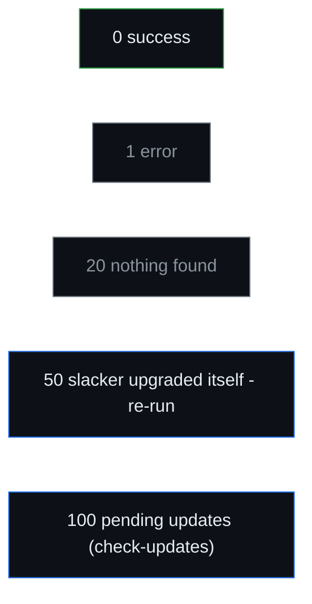

# Commands

The full reference for all **40 actions**, with the exact descriptions printed by
`slacker --help`. Run `slacker <command> --help` for a command's options, or
`man slacker` for the complete manual.

**Global flags** (any command):

| Flag | Effect |
|---|---|
| `--config-dir <DIR>` | Directory holding the plain-text config files (default `/etc/slacker`). |
| `-y`, `--yes` | Assume "yes" to confirmation prompts. |
| `--dry-run` | Show what would happen without changing the system. |
| `--no-deps` | Do not read `.dep` files / pull in dependencies for this run. |
| `-h`, `--help` | Print help. |
| `-V`, `--version` | Print version. |

---

## Metadata

| Command | What it does |
|---|---|
| `update [gpg]` | Refresh metadata from every repo. `update gpg` imports repo GPG keys. A repo whose metadata cannot be fetched (bad URL, 404, DNS) is listed as **unreachable**, never as having new content - it is still retried, but nothing is promised that will not happen. |
| `check-updates` | Check every configured repo for pending updates (**exit 100** if any). A repo that cannot be reached is reported as **unreachable (check its URL)**, distinct from one that was never updated. |
| `show-changelog [REPO]` | Print a repo's ChangeLog, read from the repo's URL each time (a `file://` repo is read from disk); a cached copy is shown only when the repo cannot be reached. With no argument, the official (tracked) repo; name a repo to show that one instead. |
| `history [NAME]` | Show a chronological log of package changes - installed, upgraded and removed, and when - newest first. Derived from the pkgtools admin directories, so it also reflects changes made outside slacker. See [[Package History]]. |

## Querying (read-only, no root)

| Command | What it does |
|---|---|
| `search [--partial\|--exact] NAME` | Find a package by name (case-insensitive). Exact by default; with `--partial`, or `SEARCH=partial` in `slacker.conf`, every package whose name contains the word is listed, the exact name first - `search --partial theme` finds `adwaita-icon-theme` and `xcursor-themes`. Only package names are searched, never descriptions or files. `--exact` asks for the exact match whatever `SEARCH` says. The `[repo]` label names where the **installed** build came from - including a local/SBo source no repo offers - and `(also: ...)` lists every other repo shipping the name **with its own version**, so a repo carrying something else entirely (`(also: testing kernel-generic-7.1.7)`) is visible without running `info`. |
| `file-search FILE` | Find which package ships a file (uses MANIFEST). |
| `info PACKAGE` | Show details and per-repo candidates for a package. For a candidate that declares dependencies, a `requires:` line lists them - read exactly as installing reads them (its `.dep` file, else `PACKAGE REQUIRED`) - and marks each one that is not pulled in, by a `nodep` rule or because it is frozen. A package that **is installed but offered by no repo** (a local or SBo build) is reported as such - with the path of its pkgtools record to `cat` - instead of "no package named ...". |
| `list-repos` | List configured repositories with priority, verify policy and how many installed packages came from each. An installed package counts for the repo that ships **that build** (else the same name with the same build tag), so a build tag two repos share - Slackware's `extra/` ships alienbob's `slackpkg+` with the `alien` tag - does not move one repo's packages to the other. |
| `status` | The setup **doctor** - checks the whole setup and says what to do next, and runs even when the config is broken (diagnosing that is its job). Verifies the environment (pkgtools and helper tools on `PATH`, config-file syntax), then mirror (and whether it is up to date with the upstream master, pointing you at `find-mirror` when it is stale), repos, priorities, verification, GPG keys (verified empirically against the keyring), metadata freshness, whether every repo targets the running system's release, blacklist (and pins, flagging any pinned to an inactive repo), an **integrity audit** of slacker's own config + cache + state (root ownership, world-writable paths, stray symlinks), installed-package sources, **build-tag priority coverage** (an installed package whose build tag has no priority line and that no repo ships cannot be ranked, so it is kept and never upgraded - `status` names those packages and the line to add), pending `.new` configs, and - if online - reachability and pending updates. Ends with the exact commands to run next, in order. |
| `find-mirror` | Find the fastest up-to-date mirror for your location: probes the official mirror list, times each one, drops stale mirrors (>48h behind the upstream master), ranks the rest by speed, lists the **7 fastest** and proposes the **3 fastest** - **never** changing your config. Runs **before a mirror is configured**, so it is the natural first command on a fresh install. Works on **-current and stable** (and on 32-bit). |

## Installing and removing

| Command | What it does |
|---|---|
| `install PATTERN...` | Install new packages (refuses already-installed ones). |
| `upgrade PATTERN...` | Upgrade installed packages to the newest available revision. |
| `reinstall PATTERN...` | Reinstall the currently installed version. |
| `remove PATTERN...` | Remove installed packages. `remove @repo` removes exactly the packages `list-repos` counts for that repo (a tagless package belongs to the official repo), never every package carrying a tag the repo also ships. |
| `download [-o DIR] PATTERN...` | Download package files without installing. Saved to the cache by default, or to a directory given with `-o`/`--output`. |
| `revert-pkg NAME` | Roll an official package back to a previous **-current** version (rollback). Lists its earlier versions from `removed_packages`, fetches the chosen build from the cumulative archive (GPG-verified against the pinned Slackware key), and downgrades with `upgradepkg --reinstall`. Official packages only and **hard-blocked outside Slackware -current** - the code reads `VERSION_CODENAME` from `/etc/os-release` and refuses (fail-closed) on a stable release, because the cumulative archive holds -current packages that would break it. Requires `REVERT=on`. See [[Common Workflows]]. |

> **A dependency left out is always shown.** When a dependency is not pulled in -
> because it is frozen, or excluded with `nodep` - and is not installed, not asked
> for and not coming in for another package, the plan prints a line such as
> `note: not pulling in 'xvfb-run' for 'blueprint-compiler' (!blueprint-compiler:xvfb-run)`,
> so a package is never installed without one of its dependencies unnoticed.

> **An argument that matches nothing cancels the whole command.** `install`,
> `upgrade`, `reinstall`, `remove` and `download` act on all of their arguments or
> none: if one matches no package, nothing is done and the miss is named, as apt,
> dnf and pacman do. `-y` does not bypass it. This is what stops
> `download fontforge ponce` - a dropped `:` - from quietly fetching fontforge
> from whichever repo outranks the others while you read "no match for 'ponce'".

## Bulk operations

| Command | What it does |
|---|---|
| `upgrade-all` | Upgrade every installed package that has a newer revision - honouring priority (no migration, no downgrade). |
| `upgrade-dist {current\|VERSION}` | **Distribution upgrade** to a different Slackware release (from 16.0 onwards). The target is an explicit argument; allowed routes are a fail-closed whitelist. UNLIKE every other command it deliberately ignores source priority and the blacklist and takes the target's version of every package. Re-points the mirror/repos, upgrades everything (core first, GnuPG chain last), runs install-new + clean-system + a second pass, and ends with a kernel reminder. `--dry-run` first. See [[Distribution Upgrade]]. |
| `install-new [REPO...]` | Install every package the selected repos provide that you don't already have - the "fill what's missing" counterpart to `install @repo`. Catches both packages newly added to the distribution and ones you removed, and stays correct across any number of updates. Honours source/tag priority and the blacklist (frozen packages are skipped); a new build/version of an installed package is an upgrade (use `upgrade-all`), not new. Default: official repo(s) only; name repos to use those instead. |
| `clean-system` | Remove installed packages no longer in the official baseline - the official repo plus any `immutable` repo. slackpkg-style: a package the distribution dropped is removed even if a third-party repo still ships the name. Kept by the blacklist, an `IGNORE_TAGS` build tag, or an immutable repo. slacker itself and a fallback kernel saved by `/boot/make-kernel-backup` (whatever `BACKUP_NAME` it was given) are never listed. See [[Common Workflows]]. |
| `clean-cache [REPO...]` | Delete downloaded package files from the cache. Repo metadata and GPG keys are never touched. Optionally limit to named repos. |
| `new-config` | Reconcile leftover `*.new` configuration files. A bulk choice applies to all at once - **(K)**eep current (leave the `.new` for later), **(O)**verwrite all (old saved as `.orig`), **(R)**emove all `.new`, or **(P)**rompt one by one (default) - and the per-file prompt adds (M)erge and (D)iff. Six files are **never** replaced, whatever you answer - `/etc/passwd`, `/etc/shadow`, `/etc/group`, `/etc/rc.d/rc.inet1.conf`, `/etc/rc.d/rc.local` and `/etc/rc.d/rc.local_shutdown` - because they hold settings unique to this machine: your accounts, your network setup, and your own start-up and shutdown commands. Each is flagged in the list with the reason it is kept, and its `.new` is left for you to merge by hand. During `upgrade-dist` only, a further **(A)**ll new choice installs every incoming config and keeps the previous one as `.bak` (the shape of the script in Patrick's upgrade HOWTO), skipping those six. |

## Blacklist

| Command | What it does |
|---|---|
| `frozen RULE...` | Add one or more blacklist rules ("freeze"). Each argument is one rule: a glob (`*`, `?`) or regex, a `series/`, or `@repo PATTERN` (quote rules with spaces). Run with no argument to list the current frozen rules. See [[Blacklist]]. |
| `unfrozen RULE...` | Remove one or more blacklist rules ("unfreeze") - the counterpart to `frozen`. Each argument must match an existing rule **exactly**, as a literal string (special characters like `.*`, `*`, `/` are never interpreted as a pattern). Run with no argument to list the current rules. See [[Blacklist]]. |
| `pin REPO:PACKAGE` | Pin a package to ONE repo, ignoring priority (e.g. `pin alienbob:vlc`) - the positive counterpart to `frozen`. Every command (incl. `upgrade-all`) then sources that package only from that repo. Stored in the `blacklist` file as `@repo 100% package`; uses an **exact** name (not a pattern); a freeze on the same package always wins. Run with no argument to list the current pins. See [[Blacklist]]. |
| `unpin PACKAGE...` | Remove a pin - the counterpart to `pin`. The package returns to normal priority-based resolution. Run with no argument to list the current pins. See [[Blacklist]]. |
| `nodep PACKAGE:DEPENDENCY...` | Never pull `DEPENDENCY` in as a dependency of `PACKAGE` (e.g. `nodep python-sqlalchemy:python-psycopg2`); any other package that requires it still gets it, and it can still be installed by name. `nodep '*:DEPENDENCY'` does it for every package (quote the `*`). One dependency per argument, exact names, no spaces; give several arguments for several. Warns when `PACKAGE` does not require `DEPENDENCY` itself and names the package one level down that does. Stored in the `blacklist` file as `!package:dependency`. Run with no argument to list the current exclusions. See [[Blacklist]]. |
| `undep PACKAGE:DEPENDENCY...` | Remove dependency exclusions - the counterpart to `nodep`, written as it lists them. Rules not found are reported and left alone. Run with no argument to list the current exclusions. See [[Blacklist]]. |

## Repositories and tags

| Command | What it does |
|---|---|
| `list-repos` | List configured repositories with priority, verify policy and installed counts. |
| `status` | The setup doctor: health-checks the whole setup - environment and config sanity, repos, whether your mirror is up to date with upstream, GPG keys, metadata, an integrity audit of config + cache, and online reachability - and says what to do next. |
| `add-repo PRIORITY NAME URL [flags]` | Add a binary repository to the `repos` file. URL must be `http://` or `https://` and unique. Flags (separate words, no quotes): `official`, `immutable` (keeps its packages out of clean-system), `subtree` (a Slackware distribution subtree - `extra/`, `patches/`, … - whose packages download from the parent/root URL), `verify=...`. See [[Repositories and Priority]]. |
| `del-repo NAME` | Remove a binary repository (by name) from the `repos` file. |
| `pri-repo PRIORITY NAME` | Change a repo's priority in the `repos` file. `NAME` must be an active repo (the closest match is suggested on a typo); `PRIORITY` must not already be used by another repo (priorities are kept distinct, and the clashing repo is named). Only that repo's priority is rewritten - its URL and flags stay untouched. See [[Repositories and Priority]]. |
| `add-tag PRIORITY NAME TAG` | Add a build-tag priority line to the `repos` file (e.g. `add-tag 100 SBo _SBo`; no quotes). |
| `del-tag TAG` | Remove a build-tag priority line (by its TAG) from the `repos` file. |

## Repository safety (quarantine model)

| Command | What it does |
|---|---|
| `vet-repo NAME` | Re-run the safety vetting on a repo on demand (fetches metadata only). Quarantines it if it fails, or clears a prior quarantine if it now passes. |
| `trust-repo NAME` | Trust a quarantined repo, lifting its freeze so it can be used again. This overrides slacker's safety verdict - at your own responsibility. |
| `distrust-repo NAME` | Manually quarantine (freeze) a repo so it provides no packages until you `trust-repo` it again. |

See [[Security]] for the trust model.

## Templates

| Command | What it does |
|---|---|
| `generate-template NAME` | Snapshot installed packages into a template. |
| `install-template NAME` | Install all packages listed in a template. |
| `remove-template NAME` | Remove all packages listed in a template. |
| `delete-template NAME` | Delete a template file (does not touch installed packages). |

See [[Templates]].

---

## Full `slacker --help`

The authoritative output, verbatim:

```text
slackpkg + slackpkg+ in one, minimal Rust tool

Usage: slacker [OPTIONS] <COMMAND>

Commands:
  update             Refresh metadata from every repo. `update gpg` imports repo GPG keys
  search             Find a package by exact name; `--partial` lists every name containing it
  file-search        Find which package ships a file (uses MANIFEST)
  info               Show details and per-repo candidates for a package
  list-repos         List configured repositories and their priorities
  status             Health-check the whole setup and report what to do next — the setup doctor
  install            Install new packages (refuses already-installed ones)
  upgrade            Upgrade installed packages to the newest available revision
  reinstall          Reinstall the currently installed version
  remove             Remove installed packages
  revert-pkg         Revert an official package to a previous -current version (rollback)
  download           Download package files without installing them
  upgrade-all        Upgrade every installed package that has a newer revision
  upgrade-dist       Distribution upgrade: 15.0 to -current or next stable
  install-new        Install the repos' packages that aren't installed yet
  clean-system       Remove installed packages no longer in the official baseline
  clean-cache        Delete downloaded package files from the cache
  new-config         Handle leftover *.new configuration files
  check-updates      Check every configured repo for pending updates (exit 100 if any)
  show-changelog     Print a repo's cached ChangeLog
  history            Show a chronological log of package changes, newest first
  find-mirror        Find the fastest up-to-date Slackware mirror
  generate-template  Snapshot installed packages into a template
  install-template   Install all packages listed in a template
  remove-template    Remove all packages listed in a template
  delete-template    Delete a template file (does not touch installed packages)
  frozen             Add blacklist rules ("freeze"); no arg lists them
  unfrozen           Remove blacklist rules ("unfreeze"); no arg lists them
  pin                Pin a package to ONE repo, ignoring priority
  unpin              Remove a pin; no arg lists current pins
  nodep              Never pull a dependency in for one package (or for any)
  undep              Remove dependency exclusions; no arg lists them
  add-repo           Add a binary repository to the `repos` file
  del-repo           Remove a binary repository (by name) from the `repos` file
  pri-repo           Change a repo's priority in the `repos` file
  add-tag            Add a build-tag priority line to the `repos` file
  del-tag            Remove a build-tag priority line (by its TAG) from the `repos` file
  vet-repo           Re-run the safety vetting on a repo on demand
  trust-repo         Trust a quarantined repo, lifting its freeze
  distrust-repo      Manually quarantine a repo so it provides no packages
  help               Print this message or the help of the given subcommand(s)

Options:
      --config-dir <CONFIG_DIR>  Directory holding the plain-text config files [default: /etc/slacker]
  -y, --yes                      Assume "yes" to confirmation prompts
      --dry-run                  Show what would happen without changing the system
      --no-deps                  Do not read .dep files / pull in dependencies for this run
  -h, --help                     Print help
  -V, --version                  Print version

Run `slacker <command> --help` for the full description and examples.
```

---

## Exit codes



| Code | Meaning |
|---|---|
| `0` | success |
| `1` | an error occurred |
| `20` | no package found to act on |
| `50` | slacker upgraded itself and must be re-run |
| `100` | there are pending updates (from `check-updates`) |

---

## Privileges and locking

Read-only commands (`search`, `info`, `file-search`, `list-repos`, `status`,
`check-updates`, `show-changelog`, `history`, `find-mirror`) run as **any
user**. Everything that changes the
system, cache, or config must be run as **root**. Mutating commands take an
exclusive lock (`/run/slacker.lock`) so only one runs at a time; queries take no
lock and run freely in parallel.
