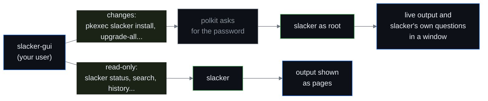

# Slacker GUI

`slacker-gui` is the graphical front-end for slacker: a GTK4/libadwaita window
over the same commands you would type in a terminal.

It holds **no package logic of its own**. There is no resolver, no GPG code and
no database in it: every piece of information on screen comes from running the
`slacker` binary and reading what it prints, and every change is made by
`slacker` itself. If the GUI and the terminal ever disagree, the terminal is
right and the GUI has a bug.

---

## Starting it

Start **Slacker GUI** from the desktop menu, or run `slacker-gui`, as your
**normal user**. It refuses to start as root (`sudo slacker-gui`): the whole
window would then run privileged. Only the single command that changes the
system runs as root, after polkit asks for the password.

It needs a polkit authentication agent in the session (every full desktop has
one) and the `slacker` package itself. `slacker-gui` always ships together with
`slacker`, so the two never differ in version.

The GUI looks for slacker in `/usr/bin`, `/usr/sbin`, `/usr/local/bin` and
`/usr/local/sbin`, in that order, and shows the path it uses at the bottom of
the sidebar. `SLACKER_BIN=/absolute/path` overrides the search (pkexec then asks
for the password every time, instead of remembering it for a few minutes).

---

## The pages

Each page of the sidebar is one slacker command; its name is written under the
page title.

| Page | Shows | Runs | Changes it can make (as root) |
|---|---|---|---|
| **Doctor** | whether the setup is healthy, row by row | `slacker status` | - |
| **Search** | packages by name (exact, or every name containing the word with `SEARCH=partial` in `slacker.conf`), with their candidates per repo | `slacker search`, `slacker info` | Install, Remove |
| **Updates** | which repositories have updates pending | `slacker check-updates` | Update, Install New, Upgrade All |
| **Changelog** | the ChangeLog of a repository | `slacker show-changelog` | - |
| **Installed** | every installed package, with its version, date and source | `slacker history --installed` | Reinstall, Remove, Freeze, Pin |
| **Repositories** | repositories by priority, with their flags and state | `slacker list-repos` | change a repository's priority |
| **Mirrors** | the fastest up-to-date mirrors (on request) | `slacker find-mirror` | - (the mirror is changed by hand) |
| **Frozen & Pins** | freeze rules, pins and dependency exclusions (on request) | `slacker frozen`, `pin`, `nodep` | add and remove all three |
| **History** | the last 300 package changes, newest first | `slacker history --last 300` | - |

### Installed

The page for browsing what is on the system.

- **Filter** by name: type part of a package name.
- **Sources**: the button next to the filter lists every source the installed
  packages come from (a repository, or a build tag such as `SBo` when no
  repository serves the package), each with its package count. Tick one or more
  to show only their packages. It combines with the name filter: tick `conraid`
  and type `lib`.
- Click the **source tag** of a row to show only that source.
- The list starts with 200 rows; **Show 200 More** and **Show All** at its end
  add the rest.
- The **⋮** menu of a row: Details, Freeze, Pin to a Repository, Dependencies,
  Reinstall, Remove. Reinstall is offered only when a configured repository
  serves the package.

### Dependencies

"Dependencies…" (on Installed and in a package's details) lists what a package
requires, one switch per dependency. Turning one off writes a dependency
exclusion (`slacker nodep package:dependency`), turning it back on removes it
(`slacker undep`). The arrow on a row opens that dependency's own list. See
[[Dependencies]].

---

## Making changes

No command the GUI runs carries `--yes`. A change opens a window with slacker's
**live output**, and slacker asks its own questions there, exactly as on a
terminal: the plan with "Proceed? [y/N]", the package picker, a dependency
conflict, the repositories to update. The GUI shows each question with buttons
or a checklist and writes your answer to slacker, as if you had typed it.

- You always see the plan **before** anything is installed, because it is
  slacker's own plan.
- If nobody answers, slacker reads end of input and takes its default, which
  for every change is **no**.
- If the output stops on a line the GUI does not recognise as a question, the
  window offers **Stop Answering**: slacker then gets end of input and declines.
- Removing a freeze rule or a pin asks nothing in slacker, so there the GUI asks
  first and shows the exact command it will run.

Commands run **one at a time**, in the order you asked for them, so a page
refresh never collides with an install.

### Command Output

Every command the GUI has run, with its complete output, is in **Command
Output**: main menu (F10) or `Ctrl+Shift+O`. When something looks wrong on a
page, this is where to look first, and what to paste into a bug report.

---

## What it does not do

These stay in the terminal, on purpose: they are long, interactive or one-way
operations where a terminal is the right place.

- `upgrade-dist`, `revert-pkg`, `clean-system`, `clean-cache`
- `new-config`: after a change the output lists any `.new` files and reminds you
  to run `slacker new-config` in a terminal. `NEWCONFIG_AFTER` never acts in the
  GUI (see [[Configuration]]).
- templates, `download`, `file-search`
- adding or removing repositories and tags, and choosing the mirror
- editing `slacker.conf`

---

## Good to know

- **Zoom**: `Ctrl` with the mouse wheel, or `Ctrl` `+` / `-` / `0`. The size is
  remembered in `~/.config/slacker-gui/zoom`.
- **Search**: `Ctrl+F` opens the Search page.
- **Proxy**: polkit clears the environment, so a proxy from environment
  variables (`PROXY=env`) does not reach the commands the GUI runs as root. Set
  the proxy itself in `slacker.conf` (`PROXY=http://host:port`); see
  [[Configuration]].
- **Pins** are marked on Search and Installed once the Frozen & Pins page has
  been read (slacker lists rules only to root, so they are read on request).
- A line of slacker's output the GUI does not recognise is shown **as printed**,
  never guessed at.
- slacker's exit codes 20 (nothing found), 50 (slacker upgraded itself) and 100
  (updates pending) are answers, not errors, and the GUI treats them so.

---

## See also

- [[Commands]] - what each command behind a page does.
- [[Package History]] - the data behind the Installed and History pages.
- [[Blacklist]] and [[Dependencies]] - freeze rules, pins and dependency
  exclusions.
- [[Security]] - verification and trust; the GUI changes none of it.
